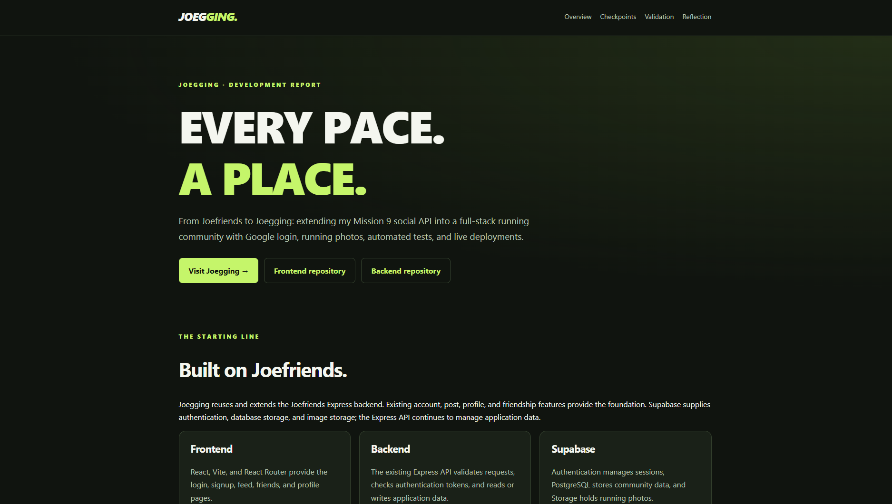

# Joegging Backend 🏃

The Express API for **Joegging**, a running community application built for Sigma School Mission 10.

This project extends my **Joefriends backend** with runner profiles and photo-post support.

## Screenshot

## Links

- [Live frontend](https://joegging-frontend.vercel.app)
- [Backend documentation](https://joegging-backend.vercel.app)
- [Frontend repository](https://github.com/joe-ship-it-nice/joegging-frontend)

## Tech Stack

- Node.js and Express
- Supabase Authentication
- Supabase PostgreSQL
- Supabase Storage
- Vercel

## Features

- Email/password signup and login endpoints.
- Bearer-token verification for protected routes.
- Authenticated runner profiles.
- Public and friends-only posts.
- Photo references saved with posts.
- Temporary signed URLs for displaying photos.
- Friend requests and acceptance.
- Request validation and error handling.

Google login happens through Supabase in the frontend. The backend verifies the resulting Supabase access token.

## API Routes

| Method | Route | Purpose |
|---|---|---|
| GET | `/` | Documentation homepage |
| POST | `/signup` | Create an account |
| POST | `/login` | Log in with email/password |
| GET | `/profile` | Get the current user's profile |
| GET | `/posts` | Get posts visible to the caller |
| POST | `/posts` | Create a post with an optional photo |
| GET | `/users` | List other users |
| GET | `/friends` | List friendships and requests |
| POST | `/friends` | Send a friend request |
| PATCH | `/friends/:id/accept` | Accept an incoming request |

## Deployment

The backend is hosted on Vercel.

## Author

**Lim Joe Onn**

*Keep moving. Keep Joegging.*
